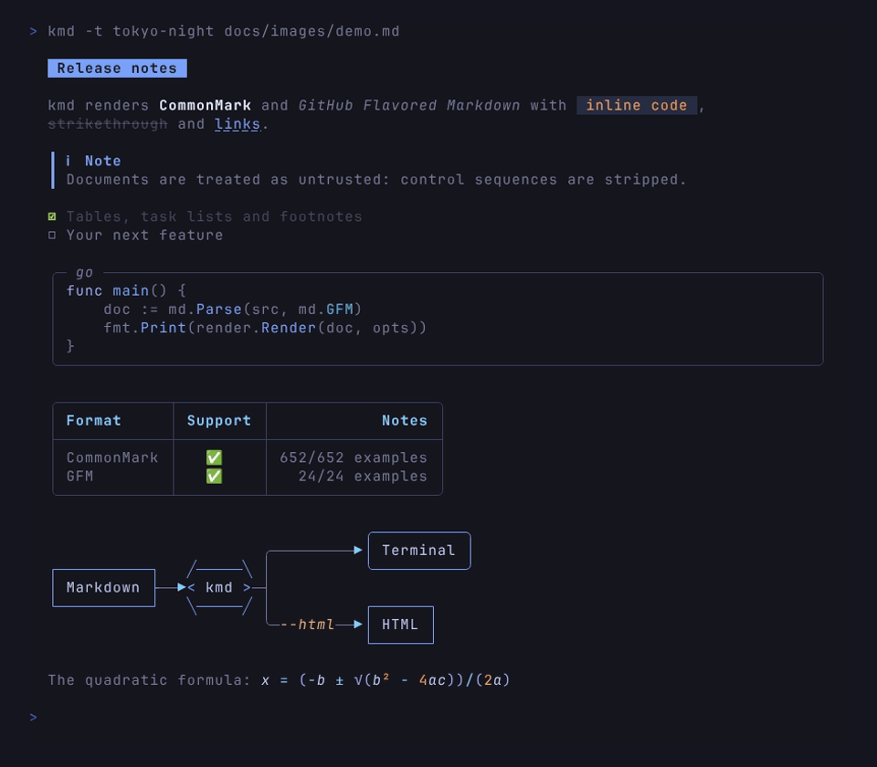
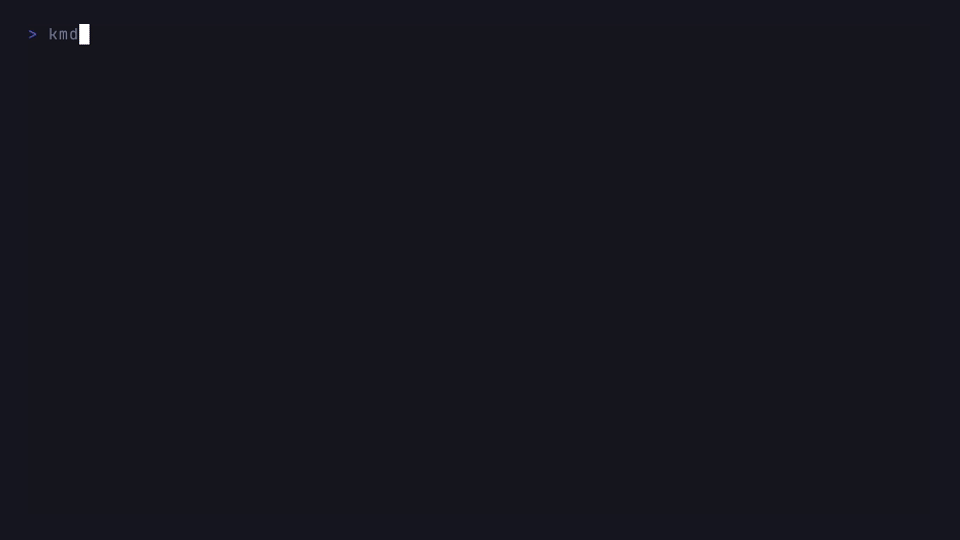
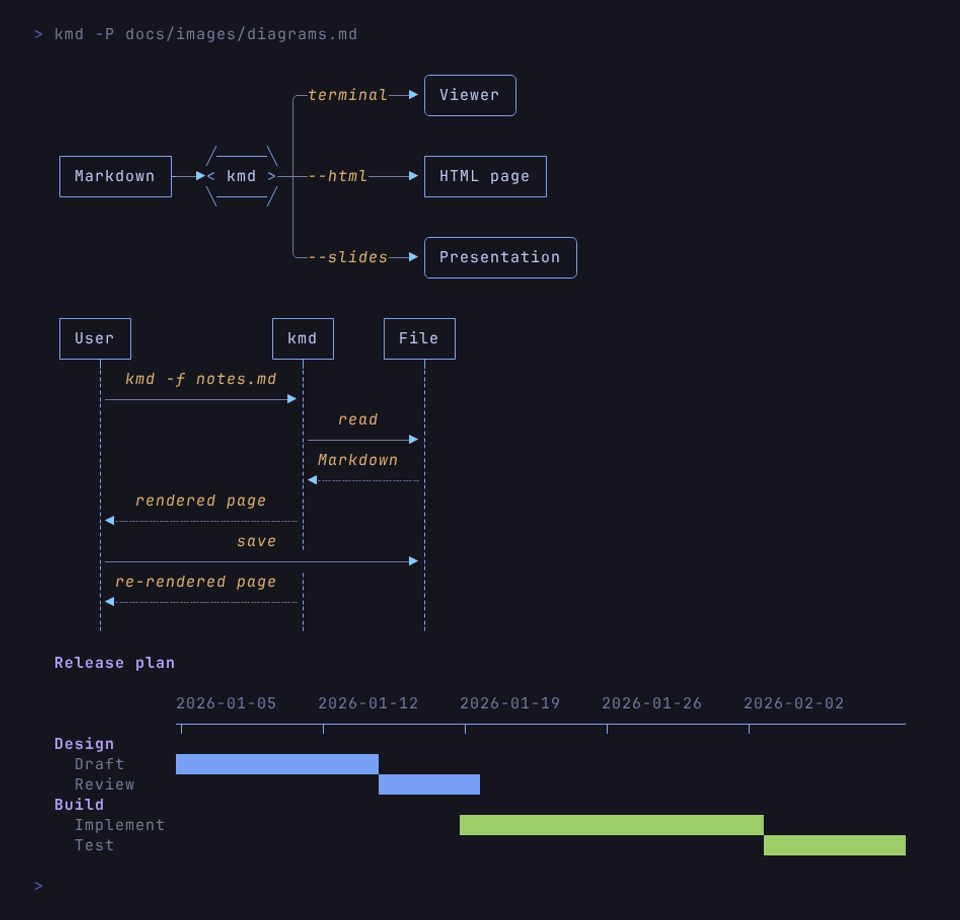
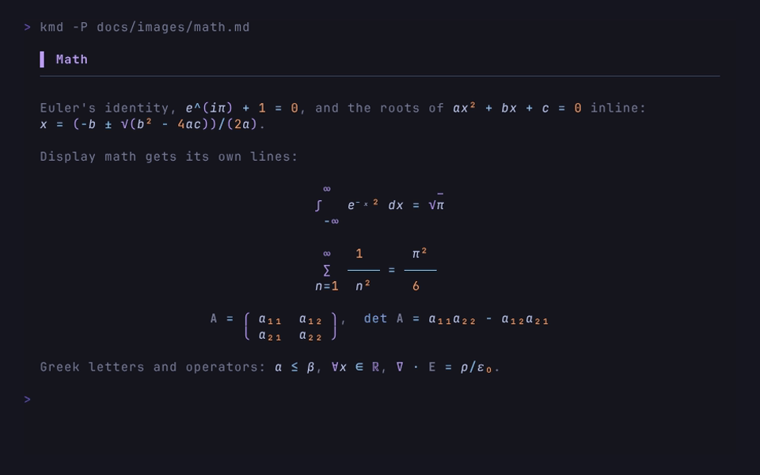
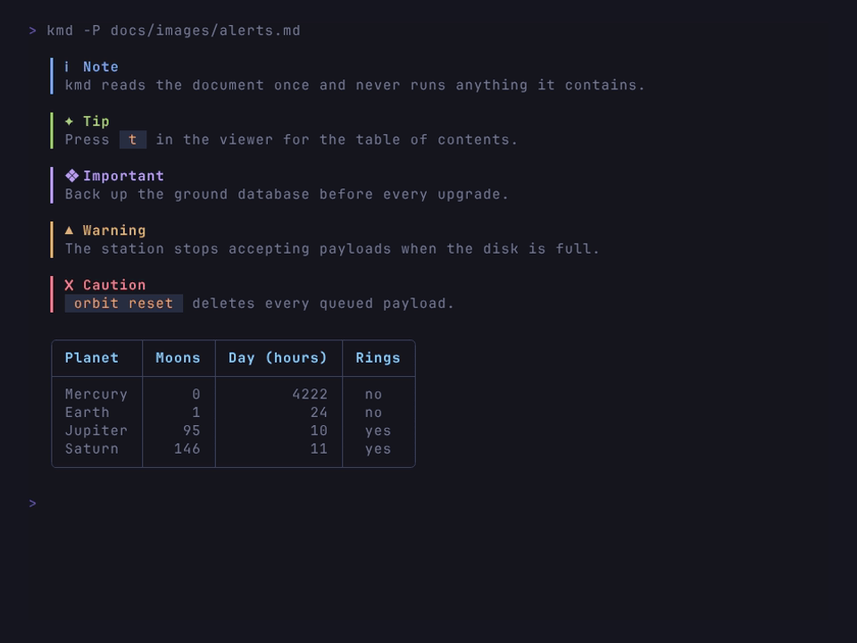
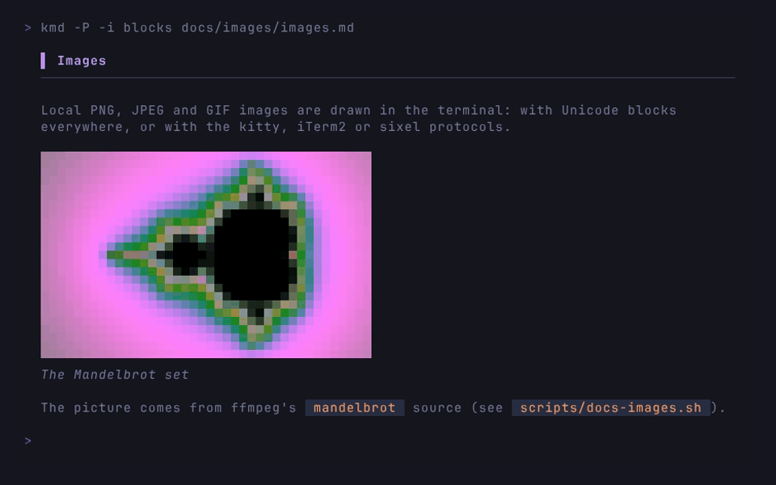
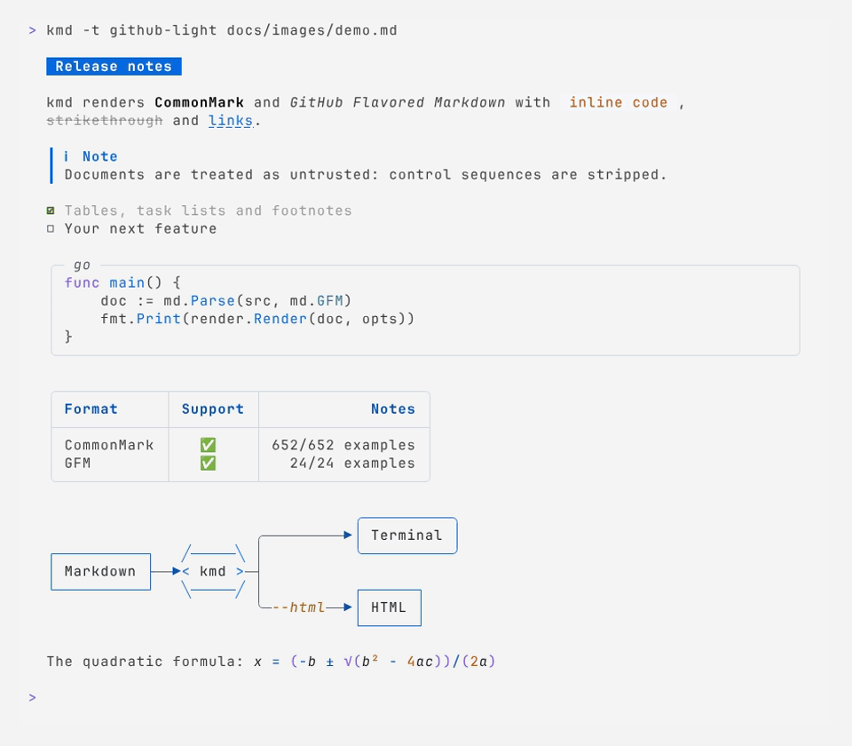
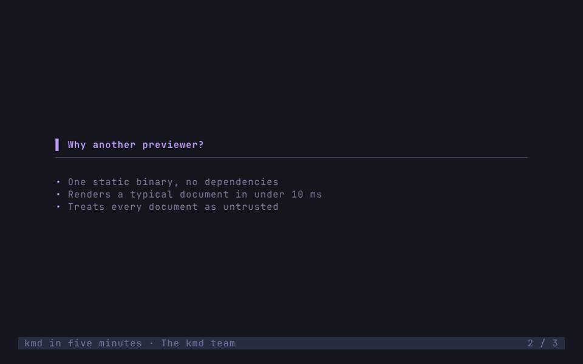
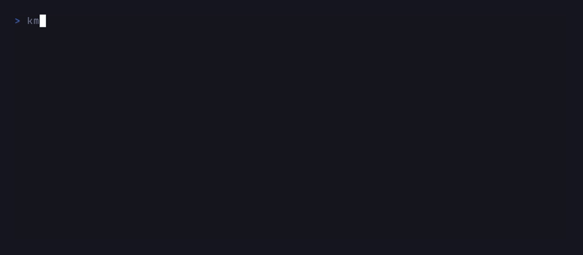

<div align="center">

# kmd

**Markdown previewer for the terminal**

[](https://github.com/DipaolaFederico/kmd/releases/latest)
[](https://github.com/DipaolaFederico/kmd/actions/workflows/ci.yml)
[](go.mod)
[](go.mod)
[](https://github.com/DipaolaFederico/kmd/releases/latest)
[](LICENSE)

[Gallery](#-gallery) · [Installation](#-installation) · [Usage](#-usage) · [Viewer](#-viewer) · [Themes](#-themes) · [Configuration](#%EF%B8%8F-configuration) · [Remote documents](#-remote-documents) · [Security](#-security)

</div>

kmd renders Markdown files in the terminal with colors, tables, syntax
highlighting, diagrams and math. It is a single static binary written in Go
with no dependencies outside the standard library, and renders a typical
document in under 10 ms, process start included. Documents are treated as
untrusted input.

<p align="center">
  
</p>

<p align="center"><sub><code>kmd -t tokyo-night docs/images/demo.md</code></sub></p>

## ✨ Features

| | Feature | Details |
|---|---|---|
| 📝 | **CommonMark** | 652/652 examples of the 0.31.2 specification, checked in CI |
| 🐙 | **GitHub Flavored Markdown** | tables, task lists, strikethrough, autolinks, footnotes, `> [!NOTE]` alerts, YAML front matter (24/24 GFM examples), `:rocket:` emoji shortcodes (about 800 GitHub names) |
| 🔗 | **Wiki links** | `[[Page]]`, `[[Page\|label]]`, `[[Page#Heading]]` link to `Page.md` next to the document, as in Obsidian |
| 🎨 | **Syntax highlighting** | 63 languages, from Go and Rust to Terraform, Nix and LaTeX ([list](#-syntax-highlighting)), in labeled boxes |
| 🧭 | **Viewer** | long documents open in a built-in viewer; links between Markdown files can be followed and navigated back |
| 🔗 | **Hyperlinks** | clickable OSC 8 links to web pages, e-mail and local Markdown or document files (relative links resolved to absolute `file://` URLs) |
| 🖼️ | **Images** | kitty, iTerm2, sixel or Unicode blocks; local files and `data:` URIs only |
| 📊 | **Diagrams** | Mermaid (flowchart, state, sequence, class, ER, Gantt, pie) and Graphviz DOT, drawn with box-drawing characters |
| ∑ | **Math** | `$…$`, `$$…$$` and ` ```math ` blocks rendered as Unicode, including fractions, roots, sums and matrices |
| 🌈 | **Themes** | 13 bundled themes; custom themes from a 17-color palette |
| 🔄 | **Live preview** | `-f` re-renders the file every time it is saved |
| 🎤 | **Presentations** | `--slides` shows a document one slide at a time |
| 🌐 | **HTML export** | standalone page with the theme colors; raw HTML and unsafe URLs removed by default |

## 📸 Gallery

Each picture shows the command that made it, run on the documents in
[docs/images](docs/images) (`make docs-images` regenerates them all).

<p align="center">
  
  <br><sub><code>kmd docs/images/guide/README.md</code>, then <code>Tab</code> <code>Enter</code> to follow a link, <code>Backspace</code> back, <code>t</code> contents, <code>/</code> search</sub>
</p>

<table>
  <tr>
    <td width="50%"><br><sub><code>kmd -P docs/images/diagrams.md</code>: Mermaid flowchart, sequence diagram, Gantt chart</sub></td>
    <td width="50%"><br><sub><code>kmd -P docs/images/math.md</code>: LaTeX as Unicode</sub></td>
  </tr>
  <tr>
    <td><br><sub><code>kmd -P docs/images/alerts.md</code>: alerts and an aligned table</sub></td>
    <td><br><sub><code>kmd -P -i blocks docs/images/images.md</code>: an image in Unicode blocks</sub></td>
  </tr>
  <tr>
    <td><br><sub><code>kmd -t github-light docs/images/demo.md</code>: a light theme</sub></td>
    <td><br><sub><code>kmd --slides docs/images/slides.md</code>: a presentation</sub></td>
  </tr>
</table>

<p align="center">
  
  <br><sub><code>kmd -f notes.md</code> while another program edits <code>notes.md</code></sub>
</p>

## 📦 Installation

| Platform | Command |
|----------|---------|
| 🍺 macOS, Linux ([Homebrew](https://brew.sh)) | `brew install DipaolaFederico/tap/kmd` |
| 🐧 Debian, Ubuntu | `sudo apt install ./kmd_*.deb` with the [`.deb` from a release](#-debian-and-ubuntu) |
| 🐧 Fedora | `sudo dnf copr enable fdipa/kmd && sudo dnf install kmd` ([more](#-fedora)) |
| 🪟 Windows ([Scoop](https://scoop.sh)) | `scoop bucket add dipaolafederico https://github.com/DipaolaFederico/scoop-bucket`<br>`scoop install kmd` |
| 🪟 Windows (winget) | `winget install DipaolaFederico.kmd` |
| ❄️ Nix | `nix run github:DipaolaFederico/kmd` · `nix profile install github:DipaolaFederico/kmd` |
| 🐹 Go | `go install github.com/DipaolaFederico/kmd@latest` (binary only) |

Every package is updated by the release workflow, with each download pinned
by SHA-256. The Homebrew, `.deb`, Fedora and Nix packages also install
the man page and the bash/zsh/fish completions. Status of each
channel: [docs/PACKAGING.md](docs/PACKAGING.md).

### Prebuilt binaries

Every [release](https://github.com/DipaolaFederico/kmd/releases/latest)
includes binaries for Linux (amd64, arm64), macOS (amd64, arm64), FreeBSD
(amd64) and Windows (amd64), `.deb` packages (amd64, arm64), a `SHA256SUMS`
file and a signed build provenance attestation. Each archive contains `kmd`,
the man page `kmd.1`, `README.md` and `LICENSE`.

```sh
# Linux amd64; for other platforms change "linux-amd64" (see the release page)
VERSION=$(curl -fsSL https://api.github.com/repos/DipaolaFederico/kmd/releases/latest \
  | sed -n 's/.*"tag_name": *"\([^"]*\)".*/\1/p')
BASE=https://github.com/DipaolaFederico/kmd/releases/download/$VERSION
ARCHIVE=kmd-$VERSION-linux-amd64
[ -n "$VERSION" ] &&
  curl -fsSLO "$BASE/$ARCHIVE.tar.gz" -O "$BASE/SHA256SUMS" &&
  sha256sum --check --ignore-missing SHA256SUMS &&
  tar -xzf "$ARCHIVE.tar.gz" &&
  install -Dm755 "$ARCHIVE/kmd" ~/.local/bin/kmd &&
  install -Dm644 "$ARCHIVE/kmd.1" ~/.local/share/man/man1/kmd.1
```

The checksum confirms the download is intact. To also confirm that the
archive was built by this repository's release workflow, verify its build
provenance with the GitHub CLI before the `install` step:

```sh
gh attestation verify "$ARCHIVE.tar.gz" --repo DipaolaFederico/kmd
```

### From source

Requires Go 1.25 or later.

```sh
git clone https://github.com/DipaolaFederico/kmd.git && cd kmd
make install                        # ~/.local/bin/kmd, man page, bash/zsh/fish completions
sudo make install PREFIX=/usr/local # system-wide
```

With Go only: `go install github.com/DipaolaFederico/kmd@latest` (installs
the binary, without the man page or completions).

### 🐧 Debian and Ubuntu

```sh
VERSION=$(curl -fsSL https://api.github.com/repos/DipaolaFederico/kmd/releases/latest \
  | sed -n 's/.*"tag_name": *"\([^"]*\)".*/\1/p')
DEB=kmd_${VERSION#v}_$(dpkg --print-architecture).deb   # amd64 or arm64
[ -n "$VERSION" ] &&
  curl -fsSLO "https://github.com/DipaolaFederico/kmd/releases/download/$VERSION/$DEB" \
       -O "https://github.com/DipaolaFederico/kmd/releases/download/$VERSION/SHA256SUMS" &&
  sha256sum --check --ignore-missing SHA256SUMS &&
  sudo apt install "./$DEB"
```

The `.deb` is covered by `SHA256SUMS` and the build provenance attestation
like the archives (`gh attestation verify "$DEB" --repo DipaolaFederico/kmd`).

### 🐧 Fedora

```sh
sudo dnf copr enable fdipa/kmd
sudo dnf install kmd
```

The package (spec and AppStream metadata in [`packaging/`](packaging)) is
built from every release. Its inclusion in the official Fedora
repositories is in progress; see [docs/PACKAGING.md](docs/PACKAGING.md).

### Shell completions

`make install`, Homebrew, `.deb`, RPM and Nix packages install
them. Otherwise:

```sh
kmd --completion bash > ~/.local/share/bash-completion/completions/kmd
kmd --completion zsh  > ~/.zfunc/_kmd     # any directory listed in $fpath
kmd --completion fish > ~/.config/fish/completions/kmd.fish
```

## 🚀 Usage

```sh
kmd README.md                 # render; opens the viewer if it does not fit on screen
kmd docs/*.md                 # several files, one after another
kmd docs/                     # a folder: its README.md, or a list of every document under it
cat notes.md | kmd            # read from standard input
kmd -f notes.md               # live preview: re-render on every save
kmd --view short.md           # open the viewer even if the document fits
kmd -P README.md | less -R    # print without the viewer
kmd --toc CHANGELOG.md        # table of contents only
kmd -s install README.md      # only the section under the "Installation" heading
kmd --html doc.md > doc.html  # export a standalone HTML page (code highlighted, diagrams drawn)
kmd --slides talk.md          # present: one slide per "---" (or per # / ## heading)
kmd --slides --html talk.md > talk.html  # the deck as a page: print it to PDF
kmd -t catppuccin-mocha doc.md
kmd -w 80 doc.md              # fixed render width
```

### Common tasks

| Task | Command |
|---|---|
| 📖 Read a project's documentation and follow its links | `kmd README.md`, then `Tab` and `Enter` |
| 🗂️ Browse a folder of notes or documentation | `kmd docs/` |
| ✍️ Preview a file while editing it | `kmd -f draft.md` |
| 📋 Get an overview of a long document | `kmd --toc doc.md` |
| 🎯 Read one section, or print it from a script | `kmd -s install README.md` |
| 📤 Share a rendered document | `kmd --html doc.md > doc.html` |
| 🎤 Present from the terminal | `kmd --slides talk.md` (`-f` reloads on save) |
| 🔌 Read a remote README (kmd itself [never fetches URLs](#-remote-documents)) | `curl -fsSL https://raw.githubusercontent.com/OWNER/REPO/main/README.md \| kmd` |
| 🖨️ Plain output for scripts or logs | `kmd -c never -P doc.md` |

### Options

```
Display:
  -w, --width N            render width (default: terminal width, max 110)
  -t, --theme NAME         theme name or path to a .theme file (default: auto)
  -c, --color WHEN         auto | always | never   (honors NO_COLOR)
  -i, --images MODE        auto | blocks | kitty | iterm2 | sixel | none
      --hyperlinks WHEN    auto | always | never
      --no-math            show LaTeX source instead of rendered formulas
      --no-diagrams        show mermaid/dot source instead of diagrams
      --commonmark         strict CommonMark (no GitHub extensions, emoji or wiki links)
      --base URL           resolve relative links of standard input against URL
  -P, --no-pager           never page long output (no viewer)
      --view               open the viewer even when the document fits
Output modes:
      --toc                print only the table of contents
  -s, --section NAME       only the section under heading NAME (anchor or text)
      --html               export a standalone HTML page (safe: raw HTML removed)
      --unsafe-html        with --html: keep raw HTML and every URL
  -f, --follow             live preview: re-render whenever the file changes
      --slides             present the document as slides
      --notes              speaker notes of the slide on screen (another terminal)
Themes and configuration:
      --list-themes        bundled and user themes (with color swatches)
      --theme-template T   print theme T as an editable file
      --config             config location, effective settings and a template
Other:
      --completion SHELL   bash | zsh | fish
  -v, --version · -h, --help
```

The full reference is in the man page: `man kmd`.

## 🧭 Viewer

Documents longer than the terminal open in kmd's viewer. Links to other
Markdown files open in the viewer itself, at the target `#heading` if there
is one, so a folder of documents can be browsed like a wiki. A folder
(`kmd notes/`, or a link to one) opens its `README.md` or `index.md`, or
else the **file picker**: every Markdown file under the folder, with its
relative path, filtered as you type (fuzzy, case-insensitive). `o` opens
the picker from any document, for the folder kmd was started on (the
document's folder, or the current folder for several files or stdin), and
`S` searches the text of all those documents and lists the matching lines
with their file, line and section.

| Picker keys | Action |
|---|---|
| typing · `Backspace` · `Ctrl-U` | filter (or the text to search) · delete a character (on an empty filter over a document: close) · clear |
| `↑` `↓` `Ctrl-P` `Ctrl-N` `PgUp` `PgDn` `Home` `End`, wheel | choose |
| `Enter`, click | open the document (a text match opens at its section, the text highlighted); in text search, `Enter` first runs the search |
| `Tab` | switch between finding files and searching their text |
| `Esc` | cancel a running search · clear the filter · close the picker (`Ctrl-C`, `Ctrl-G`: cancel or close) |

`Backspace` in a document opened from the picker returns to the list as it
was. The list skips hidden files and folders (such as `.git`),
`node_modules` and `vendor`.

| Keys | Action |
|---|---|
| `Tab` / `Shift-Tab`, click | select the next / previous link |
| `Enter` `l` `→` | open the selected link: `.md` files in the viewer; web links, images and PDFs in the desktop's default application |
| `Backspace` `h` `←` · `H` | back one document · back to the first document |
| `j` `k` `Space` `b` `d` `u` `g` `G` | scroll (arrows, PgUp/PgDn, Home/End and the mouse wheel also work) |
| `t` · `[` `]` | table of contents (choose a heading and press Enter) · previous / next section |
| `o` · `S` | file picker: find a document under the starting folder · search the text of every document there |
| `c` | copy a code block on screen to the clipboard (press again for the next block on screen) |
| `/` `n` `N` | search, next / previous match |
| `e` · `r` · `?` · `q` | edit in `$VISUAL`/`$EDITOR` and reload · reload · help · quit |

The status bar shows the target of the selected link and the documents
visited. Links that leave kmd (web, mail, desktop applications) need two
clicks: the first shows the target, the second opens it.

`c` copies the source of the code block, without the box or the colors.
Locally it uses `wl-copy`, `xclip` or `xsel` (`pbcopy` on macOS); over SSH,
or when none is installed, it asks the terminal through OSC 52, which kitty,
WezTerm, foot, Alacritty, iTerm2, Windows Terminal and tmux support.

Inside the viewer, images are drawn with Unicode blocks, since terminal
graphics protocols cannot scroll with the text (slides can: see
[Presentations](#presentations)). To use an external pager
instead, set `pager = less -R` in the configuration or `KMD_PAGER`.
`mouse = off` leaves the mouse to the terminal for text selection.

### Presentations

`kmd --slides talk.md` splits the document at every `---` line (or, when
there is none, before every `#` and `##` heading) and shows one slide at a
time, centered. `→` `Space` `PgDn` go forward, `←` `PgUp` back, `g` `G` to
the first and last slide; `j` `k` scroll a slide taller than the screen.
Links to web pages and files open as in the viewer. With `-f`, the slides
are re-rendered every time the file is saved.

A `<!-- pause -->` line reveals a slide in steps: forward shows the next
part and back hides it again. Pauses go between blocks (outside lists and
quotes); a list without blank lines between its items carries on after a
pause without a gap when it keeps the same marker, so its items can
appear one by one.

Images on a slide are drawn with the terminal's graphics protocol (kitty,
iTerm2 or sixel, as `--images` chooses; sixel needs a terminal that reports
its cell size, blocks otherwise), at most as tall as the screen
(`image-rows` in the configuration lowers that), within the per-document image limits
(see [Security](#-security)) and at most 16 MiB of them per slide. A picture is never cut: on a slide taller
than the screen it shows once it fits whole.

The bottom line is a footer for the audience: the slide number on the right
and, on the left, the `title` and `author` from the document's front
matter. A `footer:` key there replaces that text (`footer: ""` leaves only
the number), and `footer: false` (or `off`) hides the footer. A slide
taller than the screen also shows how far it is scrolled.

`kmd --slides --html talk.md > talk.html` exports the deck as one page,
with the safe defaults of `--html`: each slide a 16:9 box with its footer,
and one slide per page when printed, so the browser's *Print to PDF* makes
a PDF deck without any PDF library. Pauses show the whole slide, notes are
left out (even with `--unsafe-html`) and content taller than a slide is
cut, so split it. The colors are the theme's: `-t` with a light theme suits
paper.

Speaker notes go in `<!-- notes: … -->` comments (Markdown, several lines
if needed), which never show on the slide. Run `kmd --notes talk.md` in a
second terminal: it shows the notes of the slide the presentation of the
same file has on screen (notes are per slide, not per step), follows it
as you move, names the next slide, and stays on the last slide shown when
the presentation ends.
The two talk through a small state file in a directory only you can open
(`$XDG_RUNTIME_DIR/kmd`, or `kmd-<uid>` in the temporary directory).

```markdown
---
title: Release 2.0
author: The kmd team
---

# Release 2.0

Highlights of the quarter

<!-- notes: Thank the team before the numbers. -->

---

## New features

- Section jumps in the viewer
<!-- pause -->
- Presentations
```

## 🔤 Syntax highlighting

Fenced code blocks are highlighted for the 63 languages below, named by any of
their fence names (```` ```rust ````, ```` ```tf ````, ```` ```ps1 ````…; case does not
matter). Other names get a generic highlighter for C- and shell-like code,
and a block with no name is shown as plain text.

<details>
<summary>Languages and fence names</summary>

| Language | Fence names |
|---|---|
| Assembly | `asm`, `assembly`, `nasm`, `masm`, `gas`, `s`, `x86asm`, `armasm` |
| Awk | `awk`, `gawk`, `mawk`, `nawk` |
| Batch | `batch`, `bat`, `cmd`, `dosbatch` |
| C | `c`, `h` |
| C# | `cs`, `csharp` |
| C++ | `cpp`, `c++`, `cc`, `hpp` |
| Clojure | `clojure`, `clj`, `cljs`, `cljc`, `edn` |
| CMake | `cmake` |
| Common Lisp | `lisp`, `common-lisp`, `cl`, `elisp`, `emacs-lisp`, `el` |
| Crystal | `crystal`, `cr` |
| CSS | `css`, `scss`, `less`, `sass` |
| D | `d`, `dlang` |
| Dart | `dart` |
| Diff | `diff`, `patch` |
| Dockerfile | `dockerfile`, `docker`, `containerfile` |
| Elixir | `elixir`, `ex`, `exs` |
| Elm | `elm` |
| Erlang | `erlang`, `erl`, `hrl` |
| F# | `fsharp`, `f#`, `fs`, `fsx`, `fsi` |
| Fortran | `fortran`, `f90`, `f95`, `f03`, `f08`, `for`, `f` |
| Go | `go`, `golang` |
| GraphQL | `graphql`, `gql` |
| Groovy | `groovy`, `gradle`, `gvy` |
| Haskell | `haskell`, `hs`, `lhs` |
| HCL | `hcl`, `tf`, `tfvars`, `terraform` |
| HTML | `html`, `vue`, `svelte` |
| INI | `ini`, `conf`, `cfg`, `properties`, `env`, `dotenv` |
| Java | `java` |
| JavaScript | `js`, `javascript`, `jsx`, `mjs` |
| JSON | `json`, `jsonc`, `json5` |
| Julia | `julia`, `jl` |
| Kotlin | `kotlin`, `kt` |
| LaTeX | `latex`, `tex` |
| Lua | `lua` |
| Makefile | `make`, `makefile`, `mk` |
| Nginx | `nginx`, `nginxconf` |
| Nim | `nim`, `nims`, `nimble` |
| Nix | `nix` |
| Objective-C | `objc`, `objective-c`, `objectivec`, `m`, `mm` |
| OCaml | `ocaml`, `ml`, `mli` |
| Pascal | `pascal`, `pas`, `delphi`, `objectpascal`, `lpr`, `dpr` |
| Perl | `perl`, `pl`, `pm` |
| PHP | `php` |
| PowerShell | `powershell`, `ps1`, `psm1`, `psd1`, `pwsh`, `posh` |
| Protocol Buffers | `protobuf`, `proto`, `proto3` |
| Python | `python`, `py` |
| R | `r`, `rscript` |
| Ruby | `ruby`, `rb` |
| Rust | `rust`, `rs` |
| Scala | `scala` |
| Scheme | `scheme`, `scm`, `ss`, `racket`, `rkt` |
| Shell | `sh`, `bash`, `zsh`, `shell`, `console`, `fish`, `ksh` |
| Solidity | `solidity`, `sol` |
| SQL | `sql`, `mysql`, `postgresql`, `psql`, `sqlite` |
| Swift | `swift` |
| Tcl | `tcl`, `tk` |
| TOML | `toml` |
| TypeScript | `ts`, `typescript`, `tsx` |
| Verilog | `verilog`, `v`, `sv`, `systemverilog`, `vh`, `svh` |
| Vim script | `vim`, `vimscript`, `viml` |
| XML | `xml`, `svg` |
| YAML | `yaml`, `yml` |
| Zig | `zig` |

</details>

Adding a language takes a table entry and a golden test; see
[CONTRIBUTING.md](CONTRIBUTING.md#adding-a-language).

## 🎨 Themes

| Dark | Light |
|---|---|
| `tokyo-night` (default) | `tokyo-night-day` (default) |
| `catppuccin-mocha` | `catppuccin-latte` |
| `gruvbox-dark` | `gruvbox-light` |
| `solarized-dark` | `solarized-light` |
| `github-dark` | `github-light` |
| `dracula`, `nord`, `one-dark` | |

`kmd --list-themes` shows each theme with color swatches. With
`theme = auto` (the default), kmd picks the light or dark theme
(`light-theme` / `dark-theme` in the configuration) from the terminal's
background:

1. `COLORFGBG`, when the terminal sets it to a color number (Konsole,
   rxvt);
2. otherwise kmd asks the terminal for its background color (OSC 11),
   only when colors are on and both standard input and output are the
   terminal (never into a pipe, with `--html` or with `TERM=dumb`). kmd
   gives up on a terminal that stays silent after 0.1 s (1 s over SSH,
   where the answer takes a round trip);
3. otherwise the dark theme.

`kmd --config` shows which one decided. Most terminals answer in under a
millisecond (xterm, foot, Alacritty, Konsole, tmux), but some take longer
to answer: kitty and WezTerm about 4 ms, GNOME Terminal and other
VTE-based terminals about 16 ms. Set a theme (`-t`, `KMD_THEME` or `theme`
in the configuration) to skip the detection and that wait.

Each theme is defined by a 17-color palette from which every element
(headings, code, syntax, math, diagrams) is derived. To create a theme:

```sh
mkdir -p ~/.config/kmd/themes
kmd --theme-template nord > ~/.config/kmd/themes/mine.theme
kmd -t mine README.md
```

```ini
inherit  = nord         # start from an existing theme
blue     = #5e81ac      # change a palette color; every derived role follows
heading2 = #bf616a      # or override a single role
```

## ⚙️ Configuration

kmd reads `~/.config/kmd/config` (or `$XDG_CONFIG_HOME/kmd/config`, or the
path in `$KMD_CONFIG`). `XDG_CONFIG_HOME` and `HOME` are used only when they
are absolute paths, and `KMD_CONFIG` must be absolute. `kmd --config` prints
the file in use, the effective settings and a template.

```ini
theme       = auto
dark-theme  = catppuccin-mocha
light-theme = github-light
max-width   = 100
images      = auto
pager       = builtin   # or "less -R", or "-" to never page
mouse       = true      # click links and scroll with the wheel in the viewer
view        = auto      # "always": use the viewer even for short documents
```

Precedence: command-line flags, then environment variables (`KMD_THEME`,
`KMD_PAGER`, `NO_COLOR`), then the configuration file.

## 📚 Use as a library

The renderer is available to other Go programs as the package
[`github.com/DipaolaFederico/kmd/render`](https://pkg.go.dev/github.com/DipaolaFederico/kmd/render)
(standard library only, like kmd itself; the `kmd` command is built on it):

```sh
go get github.com/DipaolaFederico/kmd@latest
```

```go
import "github.com/DipaolaFederico/kmd/render"

theme, err := render.LoadTheme("catppuccin-mocha") // or render.DefaultTheme(dark)
if err != nil {
	return err
}
out, err := render.Render(src, render.Options{
	Width:      100,
	Theme:      theme,
	Color:      true,
	TrueColor:  true,
	Hyperlinks: true,
	Images:     render.ImagesBlocks,
	BaseDir:    filepath.Dir(path), // images are read only from inside it
})
```

`render.HTML` exports safe HTML (a fragment, or a themed page with
`Standalone`); `render.Themes`, `LoadTheme` and `ParseTheme` list and load
themes. The zero `render.Options` gives plain text with no file access, and
every call applies the same sanitisation and resource limits as the command
(see [Security](#-security)); a library caller's images are additionally
confined to `BaseDir`: absolute paths, `file:` URLs, `..` and symlinks
leading outside it are refused (hard links and mount points inside it are
the caller's to trust). With `Hyperlinks`, relative links get an
absolute `file://` target inside `BaseDir`, which therefore appears in the
output; without `BaseDir` they get none, so the process's working
directory is never revealed. `LoadTheme` reads the theme files and paths it is
given: pass it names from `Themes`, not raw user input. The functions are safe for concurrent use.
The API follows semantic versioning from v1.0.0; the rendered output itself
improves between releases and is not part of it.

## 🌐 Remote documents

kmd never makes network requests: it takes no URLs, downloads no images and
contacts no server while rendering. This is a security decision, not a
missing feature: fetching a document would tell its author when and from
where it is read (tracking pixels), and would put a network client — TLS,
proxies, redirects — inside a tool that only needs to read text. Let a tool
made for downloading do it, and pipe the document in:

```sh
curl -fsSL https://raw.githubusercontent.com/OWNER/REPO/main/README.md | kmd
```

A piped document has no folder, so its relative links and images resolve
against the current folder, as if it had been saved there. `--base` takes
the document's URL and turns its relative links into web links, as a
browser would, in the terminal, the viewer and `--html`:

```sh
curl -fsSL https://raw.githubusercontent.com/OWNER/REPO/main/README.md |
  kmd --base https://github.com/OWNER/REPO/blob/main/README.md
```

Only `http` and `https` URLs without a user name are accepted. With
`--base` the document's images are on the web too, so only inline `data:`
images are drawn; the others show their alt text, since drawing them would
mean downloading them.

## 🔒 Security

Documents are treated as untrusted (READMEs from cloned repositories,
downloads, `curl | kmd`). The design was reviewed and fuzzed against that
threat model:

- **Network**: kmd makes no network requests: no URL arguments, no image
  downloads, nothing contacted while rendering (a test checks that the
  binary does not link the `net` package). See
  [Remote documents](#-remote-documents).
- **Terminal injection**: C0/C1 control characters, DEL, Unicode bidi
  overrides ("Trojan Source") and invisible format characters (zero-width
  spaces, word joiners, tag characters…) are stripped from all document text
  on output and from copied code, including characters produced via entities
  like `&#27;`; the zero-width joiner and variation selectors that emoji need
  are kept. OSC 8 link targets must be valid UTF-8 without controls or
  invisible characters. Error messages are sanitized too, file names and
  arguments included.
- **Images**: local regular files and `data:` URIs only (with the
  [library](#-use-as-a-library), only files inside `BaseDir`), opened non-blocking
  and re-checked on the descriptor; ≤ 20 MiB and ≤ 40 megapixels checked
  *before* decoding; only PNG/JPEG/GIF; nothing is ever downloaded (no
  tracking pixels). Each file is read once per document, however it is
  named; at most 50 images, 64 MiB read from image files and `data:` URIs and
  64 MiB of image output per document; decoded pixels are not kept. Network
  and device paths (`\\host\share`, `//host`) are refused. PNGs are checked
  chunk by chunk before kitty or iTerm2 receive them; iTerm2 gets JPEG and
  GIF re-encoded as PNG.
- **`--html` export**: safe by default, like cmark: raw HTML is omitted and
  `javascript:`, `vbscript:`, `file:` and non-image `data:` URLs are dropped,
  and so are control characters, bidi overrides, invisible format characters
  and carriage returns; the page carries a restrictive
  Content-Security-Policy (no scripts, forms or `<base>`); highlighted code
  (the first 1 MiB per document) and diagrams are drawn with inline styles,
  from escaped text. `--unsafe-html`
  keeps everything (trusted input only).
- **Resource limits**: input ≤ 16 MiB, ≤ 250,000 blocks and ≤ 500,000
  inline elements (emphasis, links, code spans, line breaks…; a notice is
  shown beyond, and the rest is plain text), container nesting ≤ 100,
  inline nesting ≤ 100, tables ≤ 1,000
  columns and 524,288 cells (labels of tables shown as records ≤ 32
  columns), ≤ 100 diagrams/display formulas per document, each top-level
  block laid out in ≤ about a million styled pieces (64 MiB) and ≤ 64 MiB of
  rendered text per document (a notice is shown beyond),
  reference links copy ≤ 1 MiB + the document's size from their definitions
  (`[x]: <huge URL>` used thousands of times), source pixels scaled for
  images ≤ 200 megapixels per document, emoji shortcodes ≤ 40 bytes, wiki links ≤ 1 KiB (and only to relative
  paths: no scheme, no absolute or `//host` targets).
  Every construct known to make Markdown parsers quadratic (nested brackets,
  emphasis with links, backtick runs, unterminated comments, link
  parentheses, nested footnote references, `www.` autolinks, autolink
  parentheses) is covered by pathological tests with time limits.
- **Viewer**: a linked document is only read when the user follows the link.
  Web and `mailto:` links, and local images, PDFs and other data files, are
  handed to `xdg-open`/`open` as a single argument (never through a shell);
  links to programs, scripts or executable files are refused. Symlinks are
  resolved and checked on the real file, which must be a regular file of the
  same kind (`notes.md → ~/.ssh/id_rsa` is refused); `mailto:` links keep
  only `subject` and `body`. OSC 8 targets are only `http(s)` URLs with a
  host and no user name, `mailto:` with only `subject` and `body`, and
  absolute `file://` URLs of Markdown and document files on this computer, so
  a terminal click never runs a script or `.desktop` file, reaches another
  host or starts another program's URL handler. Local `.html` and `.svg` files are not handed to
  the browser (their scripts would run). A click on a link that leaves kmd
  (web, mail, desktop apps) first selects it and shows its target; a second
  click or Enter opens it. The target shown always has its scheme and whole
  host (the path is shortened first); web links with a user name are
  refused.
- **Documents**: only the first read of a document named on the command
  line may wait on a pipe (`kmd <(command)`); every reload is opened without
  blocking and must find a regular file. A document opened through a link or
  the picker must also be a regular file of the same kind on every reload (a
  symlink only to the same kind of file); one named on the command line is
  read wherever its name leads, as on the first read.
  Documents load in the background: `q`, Ctrl-C and termination signals
  always end the viewer and restore the terminal.
- **Configuration and themes**: the config file and theme folders come only
  from absolute `XDG_CONFIG_HOME`/`HOME` values, and `KMD_CONFIG` must be
  absolute, so a cloned folder can never supply a config (or its `pager`).
  Only theme files named with letters, digits, `.`, `-` and `_` are listed
  or completed, and the shell completions never expand theme names.
- **Speaker notes**: `--slides` writes only the number of the slide on
  screen, to a file in a directory that must belong to you and be closed to
  everyone else (mode 0700; kmd refuses one that is not, or a symbolic
  link), and removes it on exit; `--notes` reads at most 32 bytes from it
  and otherwise reads the deck as `--slides` does.
- **Terminal queries**: the only thing kmd ever asks the terminal is its
  background color, for `theme = auto` (see [Themes](#-themes)), on the
  controlling terminal and only from the foreground. The answer is read
  for about a second at most and 256 bytes, must be exactly `rgb:R/G/B` with 1–4 hex
  digits per channel, and is used only to choose between two themes; keys
  typed meanwhile are discarded, and the viewer ignores an answer that
  arrives too late. The terminal mode is restored before kmd continues,
  and also when a signal ends it meanwhile.
- **File picker**: listing a folder reads only names, breadth first, at most
  20 levels deep, 10,000 documents and 200,000 entries (a notice is shown
  beyond), in the background, without leaving the folder's file system
  (no automounted or network shares). Symlinked folders are never entered
  (no loops, nothing outside the folder); a symlinked document is listed
  only if it points directly at a regular Markdown file inside the folder
  (at most 1,000 are checked), and is checked again before a search reads
  it. Files are opened without blocking, so a FIFO swapped in cannot hang
  kmd. Document contents
  are read only by a text search the user starts: in the background,
  cancellable with Esc, ≤ 16 MiB per file, ≤ 256 MiB and 1,000 matches per
  search. File names and matching lines are sanitized like document text.

Images cost what decoding costs: a large PNG adds a few milliseconds
(`-i none` disables images; kitty passes PNGs through without decoding).

To report a vulnerability, see [SECURITY.md](SECURITY.md).

## 🤝 Contributing

Contributions are welcome. [CONTRIBUTING.md](CONTRIBUTING.md) describes the
workflow, the local CI (`make ci`) and the source layout.
What changed in each version is in [CHANGELOG.md](CHANGELOG.md).

## 📄 License

MIT. The CommonMark/GFM specification examples in `internal/md/testdata`
(CC-BY-SA 4.0) are used by the tests only.
