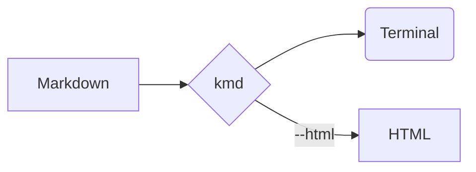

# Release notes

kmd renders **CommonMark** and *GitHub Flavored Markdown* with `inline code`,
~~strikethrough~~ and [links](https://spec.commonmark.org).

> [!NOTE]
> Documents are treated as untrusted: control sequences are stripped.

- [x] Tables, task lists and footnotes
- [ ] Your next feature

```go
func main() {
	doc := md.Parse(src, md.GFM)
	fmt.Print(render.Render(doc, opts))
}
```

| Format     | Support |            Notes |
|:-----------|:-------:|-----------------:|
| CommonMark |   ✅    | 652/652 examples |
| GFM        |   ✅    |   24/24 examples |



The quadratic formula: $x = \frac{-b \pm \sqrt{b^2-4ac}}{2a}$
