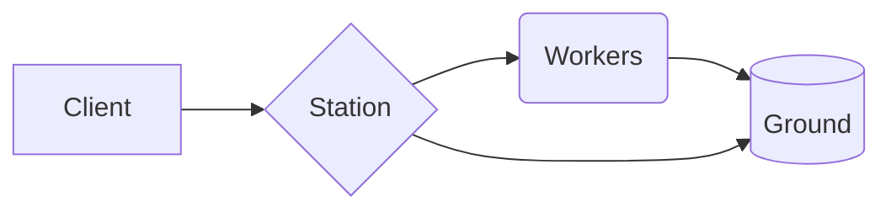

# Architecture

Back to the [handbook](README.md) · [Setting up](setup.md)

A station accepts payloads over HTTP, queues them and hands them to its
workers. Workers write the results to the ground database.
