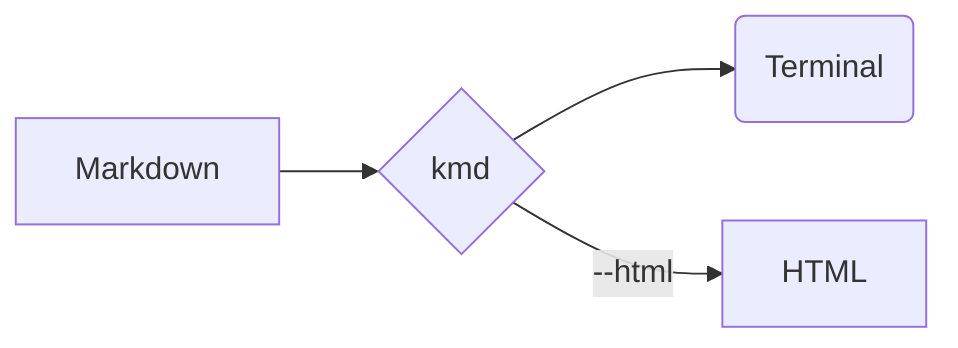
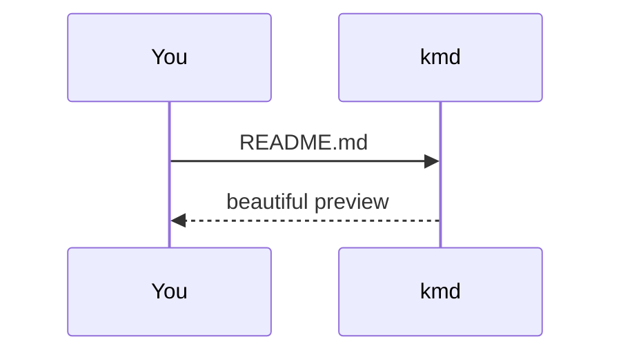
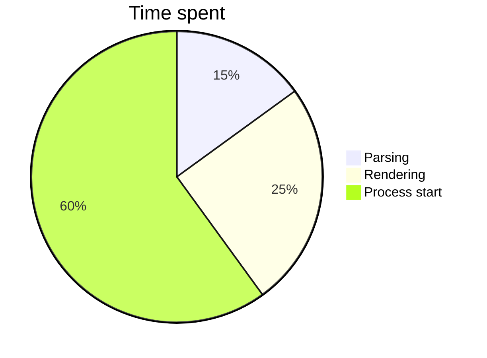

# kmd — Markdown in your terminal

A **fast**, *dependency-free* previewer with `syntax highlighting`, ~~bloat~~ and
links like [the CommonMark spec](https://spec.commonmark.org) or <https://go.dev>.
Bare URLs work too: www.commonmark.org and hello@example.com.[^1]

## Text formatting

You can combine ***bold italic***, **bold with `code` inside**, _underscored
emphasis_ and snake_case_words. Hard line breaks\
are respected, as are entities like &copy; &amp; &rarr;. Emoji shortcodes
:rocket: :white_check_mark: and wiki links such as [[README#Features|the features]] too.

> Simplicity is prerequisite for reliability.
> — *Edsger W. Dijkstra*

> [!TIP]
> Pipe any Markdown into `kmd`: `curl -s https://example.com/README.md | kmd`

> [!WARNING]
> Terminal escape sequences inside documents are stripped for safety.

## Lists

- Nested lists
  - second level
    - third level
- Item with a long line of text that should wrap nicely onto the following line while keeping its indentation aligned

1. First step
2. Second step

- [x] Parser
- [ ] World domination

## Code

```go
// Render a document.
func main() {
	doc := md.Parse(src, md.GFM)
	fmt.Println(render.Render(doc, opts)) // 42 columns
}
```

```diff
- old line
+ new line
```

## Math

The quadratic formula $x = \frac{-b \pm \sqrt{b^2-4ac}}{2a}$ inline, and as a block:

$$
\sum_{i=1}^{n} i = \frac{n(n+1)}{2}
$$

## Diagrams







## Tables

| Feature        | Status | Notes                                |
|:---------------|:------:|-------------------------------------:|
| CommonMark     |   ✅   | 652/652 spec examples                |
| GFM            |   ✅   | tables, tasks, alerts, **footnotes** |
| 日本語 width    |   ✅   | wide characters keep columns aligned |

## Images


---

#### Smaller heading

<kbd>Ctrl</kbd>+<kbd>C</kbd> copies.

[^1]: Footnotes are collected at the end of the document.
